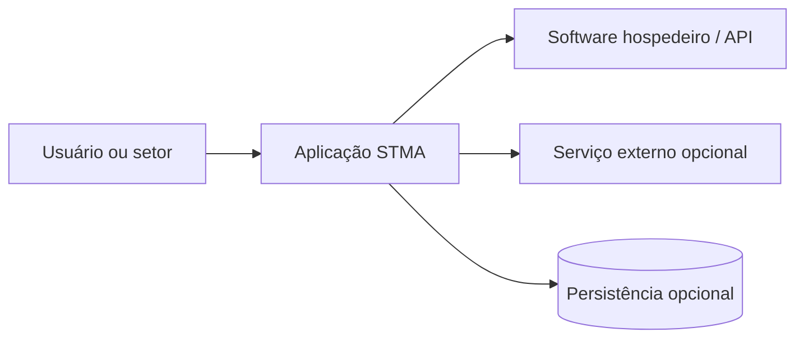
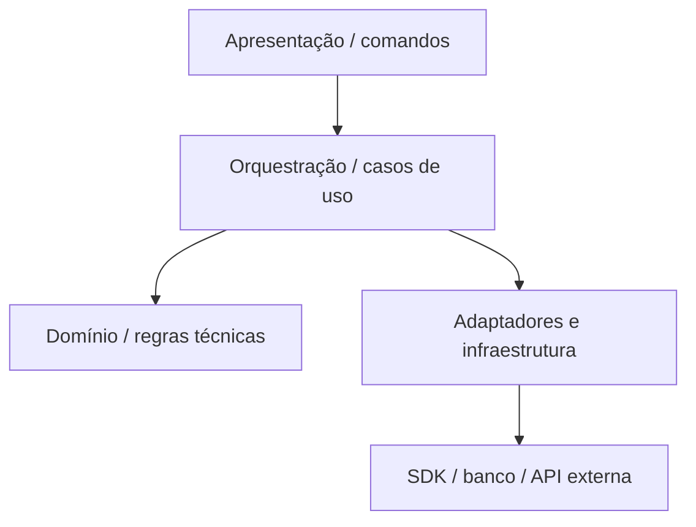
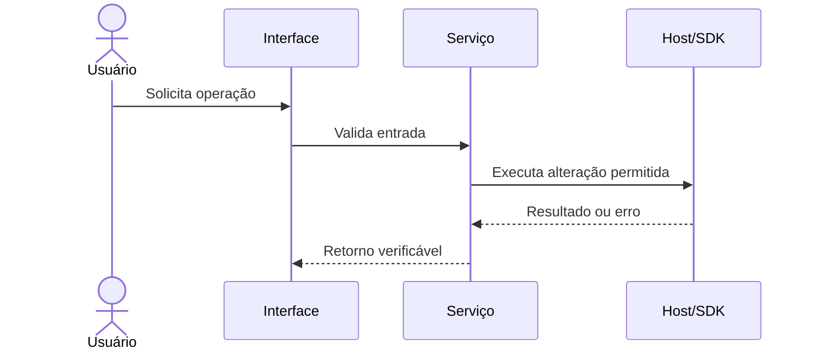

# STMA | Arquitetura Técnica do Projeto

> **Tipo:** Arquitetura de software e integração de engenharia  
> **Norma de referência:** `TI-ENG-001-NOR` · versão de referência `0.1 Beta` · **pendente de aprovação formal**  
> **Estado deste arquivo:** TEMPLATE — completar antes da revisão de arquitetura.  
> **Não tratar exemplos e campos `[PREENCHER]` como decisões implementadas.**

## Controle documental

| Campo | Valor |
|---|---|
| Projeto | `[PREENCHER: nome do produto/plugin]` |
| Repositório | `stma-[nomedoplugin]-[plataforma]` |
| Identificador do projeto | `[PREENCHER: issue/código interno]` |
| Versão do documento | `0.1.0` |
| Versão do produto documentada | `[PREENCHER: tag/commit SHA]` |
| Situação | `Rascunho / Em revisão / Aprovado / Obsoleto` |
| Responsável de desenvolvimento | `[PREENCHER: nome]` |
| Revisor de engenharia | `[PREENCHER: nome/Não aplicável]` |
| Data e última revisão | `[AAAA-MM-DD]` |
| Classificação da informação | `[PREENCHER: classificação adotada pela STMA]` |

### Histórico de revisões

| Revisão | Data | Autor | Alteração | PR/decisão |
|---|---|---|---|---|
| 0.1.0 | `[AAAA-MM-DD]` | `[NOME]` | Criação da documentação arquitetural | `[LINK]` |

## 1. Contexto arquitetural e objetivos

**Problema atendido:** `[PREENCHER: situação atual, usuários afetados e impacto]`.

**Resultado esperado:** `[PREENCHER: comportamento e valor verificáveis]`.

**Escopo arquitetural:** `[PREENCHER: o que este sistema controla, integra ou automatiza]`.

**Não objetivos:** `[PREENCHER: funcionalidades explicitamente fora do escopo]`.

**Restrições:** `[PREENCHER: prazo, licenças, versão do host, infraestrutura, acesso offline, política de TI]`.

### Atributos de qualidade

| Atributo | Meta objetiva | Método de verificação | Evidência |
|---|---|---|---|
| Confiabilidade | `[meta]` | `[teste]` | `[link]` |
| Performance | `[ex.: duração máxima para modelo de teste definido]` | `[benchmark]` | `[link]` |
| Manutenibilidade | `[meta]` | `[revisão / testes]` | `[link]` |
| Segurança | `[meta]` | `[análise de riscos]` | `[link]` |
| Compatibilidade | `[versões e plataformas]` | `[matriz de homologação]` | `[link]` |

## 2. Visão de contexto (sistema e fronteiras)

Identifique usuários, sistemas externos, dados que entram/saem e a fronteira de confiança. **Substitua o diagrama de exemplo pelos componentes reais.**

| Ator ou sistema | Papel | Interface | Dados trocados | Responsável | Confiança |
|---|---|---|---|---|---|
| `[Usuário]` | `[ação]` | `[UI]` | `[tipo]` | `[setor]` | `[limite]` |
| `[Host/SDK]` | `[função]` | `[versão/API]` | `[tipo]` | `[setor]` | `[limite]` |

## 3. Stack, runtime e compatibilidade

| Camada | Linguagem/framework | Versão fixa ou intervalo | Justificativa | Licença/restrição |
|---|---|---|---|---|
| Aplicação / plugin | `[PREENCHER]` | `[PREENCHER]` | `[PREENCHER]` | `[PREENCHER]` |
| Interface | `[PREENCHER ou N/A]` | `[PREENCHER]` | `[PREENCHER]` | `[PREENCHER]` |
| Persistência | `[PREENCHER ou N/A]` | `[PREENCHER]` | `[PREENCHER]` | `[PREENCHER]` |
| API / integração | `[PREENCHER ou N/A]` | `[PREENCHER]` | `[PREENCHER]` | `[PREENCHER]` |
| Build / testes | `[PREENCHER]` | `[PREENCHER]` | `[PREENCHER]` | `[PREENCHER]` |

**Plataformas suportadas:** `[Windows / servidor / navegadores / versões de Revit, AutoCAD etc.]`.

**Matriz de compatibilidade:**

| Plataforma/host | Versão | SDK/runtime | Situação | Evidência de teste |
|---|---|---|---|---|
| `[Revit ou outra]` | `[versão]` | `[versão]` | `Suportado / Experimental / Não suportado` | `[link]` |

## 4. Componentes e responsabilidades

| Módulo/caminho | Responsabilidade | Entradas | Saídas | Dependências permitidas | Teste associado |
|---|---|---|---|---|---|
| `[src/... ]` | `[regra]` | `[tipo]` | `[tipo]` | `[interfaces]` | `[teste]` |

**Regras de dependência:** regras de domínio não devem depender diretamente de interface visual, credenciais, implementação HTTP ou SDK do hospedeiro quando for tecnicamente viável separar essas responsabilidades. Documentar exceções e justificativas por ADR.

### Inicialização e ciclo de vida

1. **Entrada:** `[PREENCHER: comando, evento, endpoint, agendamento]`.
2. **Pré-condições:** `[PREENCHER: autenticação, modelo aberto, configurações]`.
3. **Bootstrap:** `[PREENCHER: módulos carregados e validações]`.
4. **Execução:** `[PREENCHER: caso de uso e limites transacionais]`.
5. **Finalização:** `[PREENCHER: saída, logs, rollback, descarte]`.

## 5. Fluxos críticos e regras técnicas

### FL-01 — `[Nome do fluxo]`

| Item | Descrição |
|---|---|
| Gatilho | `[evento/ação]` |
| Entradas | `[campos, tipos, unidades, origem]` |
| Pré-condições | `[invariantes e permissões]` |
| Passos | `[sequência numerada / serviço responsável]` |
| Saídas | `[artefatos, dados e alterações]` |
| Erros esperados | `[exceções, mensagens e tratamento]` |
| Idempotência | `[pode repetir? como evita duplicidade?]` |
| Transação/compensação | `[commit / rollback / operação parcial]` |
| Testes | `[IDs dos testes em TEST_PLAN.md]` |

### Regras de negócio e invariantes

- `INV-01` — `[Condição que jamais pode ser violada; ex.: não modificar elementos fora do escopo selecionado]`.
- `INV-02` — `[Regra de unidades, tolerâncias ou integridade]`.
- `INV-03` — `[Critério de autorização ou integridade transacional]`.

## 6. Dados e contratos de interface

### Dicionário de dados

| Nome | Tipo | Origem | Unidade/fuso | Validação | Persistência | Sensibilidade |
|---|---|---|---|---|---|---|
| `[campo]` | `[tipo]` | `[fonte]` | `[SI / mm / UTC / N/A]` | `[regra]` | `[onde/quanto tempo]` | `[classe]` |

### Interfaces internas e externas

| Contrato | Protocolo | Esquema/versão | Autenticação | Timeout/retry | Falhas/limites | Referência |
|---|---|---|---|---|---|---|
| `[serviço]` | `[HTTP/SDK/eventos]` | `[v1]` | `[método]` | `[política]` | `[tratamento]` | `[link]` |

- Definir políticas de evolução de schema/API e compatibilidade retroativa.
- Registrar limites de paginação, rate limit, chamadas externas e pontos de falha.
- Nunca incluir tokens, segredos, dados pessoais reais ou URLs assinadas em exemplos públicos.

## 7. Engenharia: integração com plataformas e modelos

> Preencher quando houver BIM, CAD, cálculo, automação de modelagem ou integração com disciplina de engenharia. Caso contrário, justificar `Não aplicável`.

| Aspecto | Definição obrigatória |
|---|---|
| Host / SDK / versão | `[nome e versão exata]` |
| Modelo de coordenadas | `[interno, compartilhado, origem, transformação]` |
| Unidades | `[unidades de API, conversões, arredondamento]` |
| Identificação de elementos | `[IDs estáveis / identidade e reconciliação]` |
| Transações | `[abertura, commit, cancelamento, rollback]` |
| Manipulação do documento | `[permissões, elementos afetados, prevenção de perda]` |
| Validação por disciplina | `[responsável e método]` |
| Modelos de homologação | `[arquivo controlado e versão]` |
| Limitações | `[tipos de elementos/situações não atendidas]` |

**Princípio de validação:** build bem-sucedido, testes unitários e testes de grafo **não substituem** teste funcional no software hospedeiro. Declarar separadamente `Compilou`, `Testes passaram`, `Executado no host` e `Homologado pela engenharia`.

## 8. Segurança, privacidade e limites de confiança

| Ameaça ou falha | Superfície | Impacto | Mitigação | Teste/evidência | Responsável |
|---|---|---|---|---|---|
| `[abuso ou falha]` | `[endpoint / host / arquivo]` | `[efeito]` | `[controle]` | `[ID/link]` | `[nome]` |

**Controles mínimos a avaliar:** privilégio mínimo; tratamento e validação de entrada; segredo fora do Git; segregação de ambientes; validação de dependências; logging sem dados sensíveis; operações destrutivas com confirmação e/ou rollback; exposição de APIs; classificação dos dados de engenharia e de clientes.

## 9. Operação, observabilidade e falhas

- **Logs:** `[local, nível, esquema, correlation ID, período de retenção aprovado]`.
- **Métricas:** `[latência, falhas, volume, desempenho, uso de memória conforme aplicável]`.
- **Diagnóstico:** `[como reproduzir erro e onde localizar evidências]`.
- **Degradação:** `[comportamento sem rede, sem host, sem credencial etc.]`.
- **Recuperação:** `[backup, compensação, rollback, restauração de configurações]`.
- **Suporte:** `[dono, canal, prioridade e prazo combinados]`.

## 10. Decisões arquiteturais e evolução

Registre decisões relevantes como `docs/adr/ADR-0001-[assunto].md`: contexto, alternativas, decisão, trade-offs, data e aprovadores. Não reescrever o histórico; substituir decisões por novos ADRs quando necessário.

| ID | Decisão | Estado | ADR/PR | Data |
|---|---|---|---|---|
| `ADR-0001` | `[decisão]` | `Proposta / Aceita / Substituída` | `[link]` | `[data]` |

### Dívida técnica e riscos

| ID | Risco/dívida | Probabilidade | Impacto | Mitigação | Prazo/issue |
|---|---|---|---|---|---|
| `R-01` | `[descrição]` | `[escala]` | `[escala]` | `[ação]` | `[link]` |

## 11. Evidências e aprovação arquitetural

- [ ] Diagramas representam componentes realmente implementados.
- [ ] Stack e compatibilidade têm versões explícitas.
- [ ] Fluxos críticos identificam entradas, saídas, falhas e transações.
- [ ] Regras técnicas, unidades e limites de plataforma foram revisados.
- [ ] Segurança e observabilidade têm responsáveis e verificações.
- [ ] Decisões técnicas possuem referência/ADR quando necessário.
- [ ] Arquitetura, testes e comportamento do código estão consistentes.
- [ ] Alterações relevantes serão revisadas via PR, com CI e revisor diferente do autor.

**Parecer da revisão:** `[APROVADO / APROVADO COM RESSALVAS / REPROVADO]`  
**Revisor de desenvolvimento:** `[nome, data, referência PR]`  
**Revisor de engenharia (se aplicável):** `[nome, data, evidência]`  
**Pendências:** `[links para issues]`

## Referências cruzadas

- `PROJECT_BRIEF.md` — motivação, escopo e aceite.
- `DEVELOPMENT.md` — funcionamento detalhado e execução do projeto.
- `TEST_PLAN.md` — verificação de requisitos, riscos e invariantes.
- `AI_USAGE_LOG.md` — rastreabilidade de uso relevante de IA.
- `.github/PULL_REQUEST_TEMPLATE.md` — revisão e entrega de alterações.
