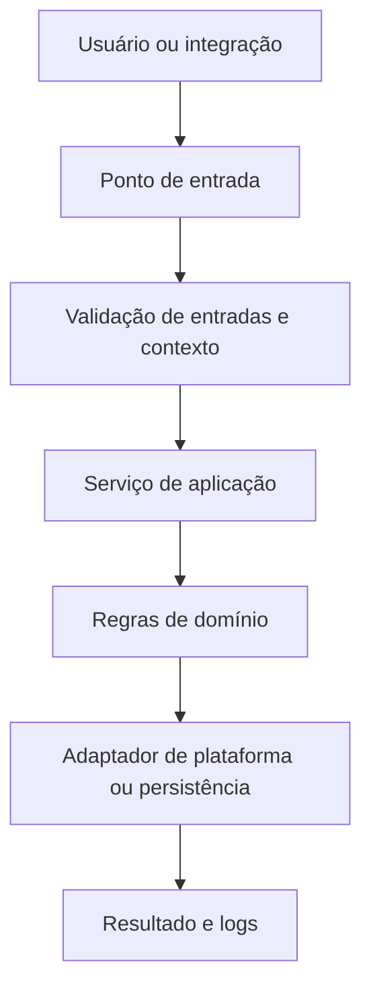

# STMA | Documentação de Desenvolvimento do Projeto

> **MODELO MESTRE · BETA 0.1**  
> **Norma de referência:** `TI-ENG-001-NOR` — Engenharia, Automação & Software  
> **Aplicação:** todos os projetos de software, plugins e automação desenvolvidos pela STMA  
> **Arquivo recomendado no repositório:** `DEVELOPMENT.md`  
> **Situação:** modelo proposto, sujeito à aprovação da liderança STMA.

<!--
INSTRUÇÕES DE USO DO MODELO
1. Copie este arquivo para a raiz de cada novo repositório e renomeie como DEVELOPMENT.md.
2. Substitua todos os campos entre [colchetes] por informações verificadas do projeto.
3. Remova instruções HTML e exemplos que não se aplicam antes da primeira release.
4. Se uma seção não se aplica, escreva "Não se aplica" e justifique brevemente.
5. Não marque uma funcionalidade como implementada sem código e evidência correspondente.
6. Mantenha este arquivo sincronizado com a implementação: alterações relevantes exigem atualização no mesmo PR.
7. A documentação não substitui testes, revisão por pares, normas de engenharia ou o README.md.
-->

## Controle documental

| Campo | Informação |
|---|---|
| Organização | STMA · Sistema Engenharia |
| Projeto | [Nome oficial / comercial] |
| Repositório | `stma-[nomedoplugin]-[plataforma]` |
| Identificação do documento | [Identificador próprio do projeto, caso definido] |
| Norma de referência | `TI-ENG-001-NOR` |
| Versão do documento | `0.1.0` |
| Versão do software | `0.1.0` |
| Status | [Planejamento / Desenvolvimento / Homologação / Produção / Descontinuado] |
| Autor / responsável técnico | [Nome / setor] |
| Revisor | [Nome / setor] |
| Aprovação | [Pendente / nome e data] |
| Atualizado em | [AAAA-MM-DD] |
| Classificação da informação | [Interno / Restrito / Público — conforme política vigente] |

### Histórico de revisões

| Data | Versão doc. | Autor | Mudança | PR / aprovação |
|---|---|---|---|---|
| [AAAA-MM-DD] | 0.1.0 | [Nome] | Criação da documentação | [Link] |

---

## 1. Visão geral e contexto

### 1.1 Resumo executivo

[Descreva em 4–8 linhas o problema real, a solução, os usuários, a plataforma e o benefício esperado. Separe claramente o que já existe do que está planejado.]

### 1.2 Problema e justificativa

- **Processo atual:** [Como a atividade é realizada hoje]
- **Dificuldade identificada:** [Retrabalho, tempo, incompatibilidade, erro humano, ausência de rastreabilidade etc.]
- **Solução proposta:** [O que será automatizado ou disponibilizado]
- **Benefício mensurável:** [Indicador, linha de base e meta — caso existam]
- **Limitações conhecidas:** [O que o projeto ainda não resolve]

### 1.3 Escopo

**Incluído:**
- [Funcionalidade 1]
- [Funcionalidade 2]

**Excluído:**
- [Funcionalidade que não faz parte desta entrega]

**Critérios de aceite:**
- [CA-01] Dado [cenário], quando [ação], então [resultado verificável].
- [CA-02] [Comportamento esperado, incluindo falhas e limites].

### 1.4 Público e responsáveis

| Papel | Responsável | Atribuição |
|---|---|---|
| Product owner / solicitante | [Nome / área] | Priorização e aceite funcional |
| Desenvolvimento | [Nome / área] | Implementação, testes e manutenção |
| Engenharia responsável | [Nome / disciplina ou N/A] | Validação do comportamento técnico e resultados |
| Revisor do PR | [Nome] | Análise de qualidade, segurança e consistência |
| Operação / suporte | [Nome / área] | Implantação, incidentes e continuidade |

> O aceite de engenharia é obrigatório quando a solução interfere em elementos, parâmetros, quantitativos, documentos ou decisões técnicas de engenharia. A aprovação do software não substitui a responsabilidade profissional aplicável.

## 2. Stack tecnológica e compatibilidade

> **Obrigatório:** registrar a stack **realmente utilizada**, incluindo versões. Não listar linguagens ou ferramentas apenas por estarem previstas.

### 2.1 Linguagens, frameworks e ferramentas

| Camada | Linguagem / tecnologia | Versão | Aplicação no projeto | Referência |
|---|---|---|---|---|
| Interface | [Ex.: TypeScript / XAML / HTML / N/A] | [Versão] | [Telas, componentes etc.] | [Pasta / link] |
| Lógica de negócio | [Ex.: C# / TypeScript / Python] | [Versão] | [Serviços, comandos, cálculos] | [Pasta / link] |
| API / backend | [Tecnologia ou N/A] | [Versão] | [Endpoints / processos] | [Pasta / link] |
| Persistência | [SGBD / arquivos / N/A] | [Versão] | [Dados persistidos] | [Pasta / link] |
| Hospedeiro / SDK | [Ex.: Autodesk Revit API] | [Versão exata] | [Integração com a plataforma] | [Documentação] |
| Build / testes | [Ferramentas] | [Versão] | [Compilação / execução] | [Scripts / CI] |
| Infraestrutura | [Ambiente / serviço / N/A] | [Versão] | [Hospedagem / distribuição] | [Registro] |

### 2.2 Plataformas suportadas

| Plataforma | Versão | SO / arquitetura | Status | Observação |
|---|---|---|---|---|
| [Ex.: Revit] | [2026] | [Windows x64] | [Testada / Prevista / Não suportada] | [Restrição] |
| [Ex.: navegador] | [Versões] | [Ambiente] | [Status] | [Restrição] |

- **Versão mínima exigida:** [Versões de runtimes, SDKs e ferramentas].
- **Dependências externas:** [Nome, versão, licença, motivo de uso].
- **Licenças e redistribuição:** [Restrições de distribuição e componentes de terceiros].
- **Matriz de compatibilidade verificada em:** [AAAA-MM-DD].

## 3. Organização do repositório

**Convenção STMA (obrigatória):** `stma-nomedoplugin-plataforma`.

- Letras minúsculas ASCII, números e hífens; sem espaços, acentos ou underscores.
- O nome do produto/plugin deve ser estável e a plataforma deve refletir seu ambiente principal.
- **Exemplos:** `stma-mustmep-revit`, `stma-mustelectrical-revit`, `stma-relatorios-web`.

**Estrutura de referência (adaptável à stack):**

```text
stma-[nomedoplugin]-[plataforma]/
├── README.md                 # Visão inicial, requisitos e primeiros passos
├── DEVELOPMENT.md            # Este documento: funcionamento interno e padrões
├── CHANGELOG.md              # Histórico de releases
├── .gitignore
├── .github/
│   ├── workflows/            # CI, validação, empacotamento (se aplicável)
│   └── PULL_REQUEST_TEMPLATE.md
├── docs/
│   ├── architecture.md       # Diagramas e arquitetura detalhada
│   ├── adr/                  # Decisões arquiteturais
│   ├── user-guide.md         # Manual para usuários finais
│   └── ai-usage-log.md       # Registro de usos relevantes de IA
├── src/                      # Código de produção
├── tests/                    # Testes automatizados e fixtures
├── examples/                 # Dados/modelos de exemplo sem informação sigilosa
└── scripts/                  # Build, validação, release e manutenção
```

| Diretório / módulo real | Responsabilidade | Ponto de entrada | Dependências principais |
|---|---|---|---|
| `[src/...]` | [O que implementa] | `[arquivo/classe/função]` | [Módulos] |
| `[src/...]` | [O que implementa] | `[arquivo/classe/função]` | [Módulos] |

> Se a stack exige outra estrutura (por exemplo, solução `.sln` com múltiplos projetos ou monorepo), documentar a organização efetiva; não reorganizar código apenas para imitar o exemplo.

## 4. Arquitetura e funcionamento do código

> **Esta é a seção central.** Um desenvolvedor novo deve conseguir identificar como a aplicação inicia, como os dados circulam, onde as regras são aplicadas e como localizar uma falha.

### 4.1 Modelo arquitetural

- **Estilo adotado:** [Ex.: modular monolith / arquitetura em camadas / hexagonal / plugin orientado a comandos].
- **Motivação:** [Por que esta abordagem foi escolhida].
- **Principais limites:** [O que UI, domínio, infraestrutura e integrações podem acessar].
- **Diagrama:** [`docs/architecture.md` ou caminho].
- **ADRs relevantes:** [`docs/adr/0001-...md`].

### 4.2 Inicialização e ciclo de vida

1. **Entrada:** [Evento que inicia: comando do plugin, rota HTTP, clique do usuário, job etc.].
2. **Inicialização:** [Classe/arquivo responsável, configuração e serviços criados].
3. **Validação:** [Pré-condições, permissões, versão da plataforma, dados].
4. **Processamento:** [Serviços e regras acionados, na ordem].
5. **Persistência / efeito:** [Alterações em modelo, banco, arquivos ou serviço externo].
6. **Saída:** [Resposta, interface, relatório, alteração de elemento].
7. **Falhas e recuperação:** [Tratamento, rollback, logs e feedback ao usuário].

**Sequência de exemplo a substituir pela implementação real:**



### 4.3 Mapa de módulos

| Módulo / namespace | Objetivo | Entradas | Saídas | Restrições |
|---|---|---|---|---|
| `[Nome real]` | [Responsabilidade única] | [Tipos/eventos] | [Tipos/efeitos] | [O que não deve fazer] |
| `[Nome real]` | [Responsabilidade única] | [Tipos/eventos] | [Tipos/efeitos] | [O que não deve fazer] |

### 4.4 Fluxos críticos

Descrever **cada fluxo relevante** usando o formato abaixo (replicar conforme necessário).

#### FL-01 — [Nome do fluxo]

- **Gatilho:** [Como o fluxo começa].
- **Pré-condições:** [Estado necessário].
- **Entrada:** [Tipos, origem, formato e validação].
- **Passos do código:**
  1. `[Arquivo/Classe.Metodo()]`: [Responsabilidade].
  2. `[Arquivo/Classe.Metodo()]`: [Responsabilidade].
  3. `[Arquivo/Classe.Metodo()]`: [Responsabilidade].
- **Saída / alteração produzida:** [Resultado observável].
- **Tratamento de erros:** [Comportamento em entradas inválidas, ausência de dados ou falha de integração].
- **Teste que comprova:** `[tests/...]` / [identificador].
- **Issue / requisito:** [Link].

### 4.5 Regras de negócio e invariantes

| ID | Regra obrigatória | Onde é implementada | Como é testada |
|---|---|---|---|
| RN-01 | [Ex.: uma operação não altera dados fora do conjunto selecionado] | `[arquivo:classe]` | `[teste]` |
| RN-02 | [Ex.: executar duas vezes não deve criar duplicações indevidas] | `[arquivo:classe]` | `[teste]` |

Documentar explicitamente unidades, tolerâncias, precisão, arredondamento, estado mutável, idempotência e condições de borda quando fizerem parte do domínio.

## 5. Contratos, dados e integrações

### 5.1 Modelos de dados

| Entidade / DTO | Campos essenciais | Origem | Validação | Persistência |
|---|---|---|---|---|
| `[Nome]` | `[campo:tipo]` | [Fonte] | [Regras] | [Destino / N/A] |

### 5.2 Interfaces e integrações

| Integração / contrato | Protocolo ou API | Versão | Autenticação | Falhas / timeout | Responsável |
|---|---|---|---|---|---|
| [Sistema / biblioteca / SDK] | [REST, SDK, arquivo etc.] | [Versão] | [Método / N/A] | [Política de erro] | [Setor] |

Para APIs HTTP, documentar rotas, métodos, esquemas de request/response, códigos de status e versionamento; preferir contrato OpenAPI quando aplicável. Para arquivos, documentar esquema, codificação, convenção de nome e compatibilidade. **Nunca inserir chaves, tokens, senhas ou URLs com credenciais neste documento.**

### 5.3 Migrações e compatibilidade de dados

- **Mudanças incompatíveis:** [Como são detectadas e comunicadas].
- **Estratégia de migração:** [Script, backup, validação e reversão].
- **Retenção e privacidade:** [Regras aprovadas pela STMA, quando definidas].

## 6. Requisitos específicos de engenharia e plugins

> Preencher quando houver Revit, AutoCAD, BIM, CAD, cálculos, quantitativos, automação de documentos ou outra integração de engenharia. Caso contrário: **Não se aplica — [justificativa]**.

| Tema | Registro obrigatório |
|---|---|
| Software hospedeiro | [Produto, edição, versão e build testadas] |
| SDK / API | [Versão, dependências e limitações] |
| Disciplinas afetadas | [Elétrica / MEP / hidráulica / PPCI / estrutura / outras] |
| Elementos e parâmetros | [Categorias, classes, parâmetros, IDs, GUIDs, nomes compartilhados] |
| Unidades e coordenadas | [Unidades internas, unidades de exibição, transformações e tolerâncias] |
| Transações e operações | [Abertura, commit, rollback, falha parcial, undo quando disponível] |
| Segurança do modelo | [Quando é somente leitura, quando escreve, como previne perda de dados] |
| Restrições do hospedeiro | [Contexto de execução, thread, documento ativo, eventos, API limitations] |
| Modelos de teste | [Caminhos/versionamento de arquivos desidentificados] |
| Validação de engenharia | [Responsável, critérios e evidências] |

### 6.1 Cenários mínimos de validação técnica

- **Cenário válido:** [Modelo representativo e resultado esperado].
- **Modelo vazio ou incompleto:** [Tratamento sem travamento].
- **Elementos ausentes, duplicados ou desconectados:** [Comportamento].
- **Unidades / coordenadas / transformações:** [Verificação].
- **Reexecução do comando:** [Sem efeitos cumulativos indesejados, quando aplicável].
- **Falha durante escrita:** [Rollback e integridade do modelo].
- **Compatibilidade por versão:** [Evidência por versão suportada].

**Matriz de verificação:**

| Caso | Ambiente / modelo | Esperado | Obtido | Evidência | Resultado |
|---|---|---|---|---|---|
| [ENG-001] | [Versão e modelo] | [Critério] | [Observado] | [Link / arquivo] | [Aprovado / Reprovado / Não executado] |

> **Não declarar “testado no Revit/AutoCAD” apenas porque o build compilou ou os testes sem interface passaram.** Registrar separadamente compilação, testes automatizados, testes de integração e execução real no software hospedeiro.

## 7. Padrões de desenvolvimento

### 7.1 Princípios obrigatórios

1. **Legibilidade:** nomes claros, funções coesas, comentários que expliquem intenção ou limitações (não narração óbvia).
2. **Separação de responsabilidades:** lógica de domínio isolada de UI, armazenamento e dependências específicas da plataforma sempre que viável.
3. **Código verificável:** alterações com critérios de aceite, testes proporcionais ao risco e evidências.
4. **Previsibilidade:** tratar falhas explicitamente, evitar efeitos colaterais implícitos e mudanças de estado não controladas.
5. **Compatibilidade:** preservar contratos públicos e documentar alterações incompatíveis.
6. **Segurança:** validar entradas, aplicar privilégio mínimo, não registrar dados sensíveis e nunca versionar segredos.
7. **Manutenibilidade:** evitar dependências desnecessárias, código morto, duplicações e configurações ocultas.
8. **Consistência:** aplicar ferramentas automáticas de formatação, análise estática e testes compatíveis com a stack.

### 7.2 Convenções da stack (preenchimento obrigatório)

| Assunto | Padrão do projeto | Regra / configuração |
|---|---|---|
| Formatação | [Ferramenta e arquivo] | [Como executar] |
| Lint / análise estática | [Ferramenta e arquivo] | [Severidade / política] |
| Nomenclatura | [Classes, métodos, arquivos, diretórios] | [Regra / referência] |
| Tipagem / nulidade | [Ex.: strict / nullable enabled] | [Escopo / exceções] |
| Erros e exceções | [Política] | [Onde logar e como informar usuário] |
| Dependências | [Gerenciador / lockfile] | [Como atualizar e revisar] |
| Configuração | [Variáveis / arquivos] | [Valores padrão e validação] |
| Logs | [Biblioteca / formato] | [Níveis e contexto] |
| Cobertura / quality gate | [Critério acordado] | [Como auditar] |

**Arquivos de configuração:** `[.editorconfig]`, `[eslint.config.*]`, `[*.csproj]`, `[pyproject.toml]` ou equivalentes realmente presentes no repositório.

### 7.3 Decisões arquiteturais (ADR)

Mudanças estruturais relevantes exigem registro em `docs/adr/` com **contexto**, **alternativas**, **decisão**, **consequências**, **data** e **responsável**. Não apagar ADRs anteriores: registrar substituição e referência cruzada.

## 8. Git, revisão e versionamento

### 8.1 Branches

| Branch | Uso | Regra |
|---|---|---|
| `main` | Estado estável / liberado | Protegida; sem push direto |
| `feature/<ticket>-<descricao>` | Nova funcionalidade | Criada a partir da base definida |
| `fix/<ticket>-<descricao>` | Correção de defeito | Vincular issue e teste de regressão |
| `hotfix/<ticket>-<descricao>` | Incidente urgente | Documentar urgência e revisão posterior |

Exemplos: `feature/ENG-142-exportacao-pdf`, `fix/ENG-158-calculo-unidades`.

### 8.2 Commits

Adotar **Conventional Commits**, com prefixos como `feat:`, `fix:`, `docs:`, `refactor:`, `test:` e `chore:`.

```text
feat: adiciona validação de conectividade dos conduítes
fix: corrige conversão de unidades na exportação
docs: documenta arquitetura do módulo de relatórios
```

### 8.3 Pull request: conteúdo mínimo

- Issue / solicitação vinculada e descrição objetiva da mudança.
- Escopo e arquivos/módulos afetados.
- Riscos, impactos em versões existentes e plano de reversão quando necessário.
- Testes executados **com resultados reais** e distinção entre ambientes.
- Capturas, logs sanitizados, modelos de teste ou outras evidências.
- Atualização de `DEVELOPMENT.md`, `README.md`, `CHANGELOG.md` e ADR, conforme o impacto.
- Revisão por **pelo menos uma pessoa diferente** e CI aprovado, salvo exceção emergencial registrada.

### 8.4 Releases

- **Versão:** SemVer `MAJOR.MINOR.PATCH`.
- **Tag:** `vMAJOR.MINOR.PATCH` (ex.: `v1.2.3`).
- **Changelog:** registrar alterações por release em `CHANGELOG.md`.
- **Artefatos:** identificar versão, plataforma-alvo, checksum se pertinente, instruções e forma de rollback.
- **Compatibilidade:** atualizar matriz de versões suportadas.

## 9. Configuração, build e execução

### 9.1 Pré-requisitos

- [Sistema operacional, runtime, SDK, IDE, pacotes e versões].
- [Permissões de acesso e dependências internas].
- [Licenças de softwares hospedeiros quando necessárias].

### 9.2 Instalação para desenvolvimento

```bash
# Substituir por comandos reais testados no repositório.
# Exemplo ilustrativo; não é instrução de execução pronta.
# git clone <URL-INTERNA-DO-REPOSITORIO>
# cd stma-[nomedoplugin]-[plataforma]
# [instalar dependências]
```

### 9.3 Configuração por ambiente

| Variável / ajuste | Finalidade | Ambiente | Origem segura / valor de exemplo |
|---|---|---|---|
| `[NOME_VARIAVEL]` | [Uso] | [dev/homolog/prod] | `[valor-ficticio]` |

- **Ambientes:** desenvolvimento, homologação e produção com configurações e credenciais próprias.
- **Segredos:** usar o mecanismo aprovado pelo ambiente; não commitar `.env` com dados reais, tokens ou arquivos de credenciais.
- **Configuração de referência:** [Caminho para `.env.example` ou equivalente, sem segredos].

### 9.4 Comandos oficiais do projeto

| Operação | Comando realmente executável | Resultado esperado |
|---|---|---|
| Restaurar dependências | `[comando]` | [Resultado] |
| Compilar | `[comando]` | [Resultado] |
| Executar localmente | `[comando]` | [Resultado] |
| Testes unitários | `[comando]` | [Resultado] |
| Testes de integração | `[comando]` | [Resultado] |
| Formatar / lint | `[comando]` | [Resultado] |
| Gerar release | `[comando]` | [Artefato / diretório] |

### 9.5 Diagnóstico rápido

| Sintoma | Causa provável | Como investigar | Correção / mitigação |
|---|---|---|---|
| [Falha] | [Hipótese] | [Log / teste / caminho] | [Procedimento] |

## 10. Estratégia de testes e evidências

### 10.1 Pirâmide de testes ajustada ao risco

| Tipo | O que comprova | Ambiente | Local dos testes |
|---|---|---|---|
| Unitário | Regras e algoritmos isolados | [Runtime] | `[tests/...]` |
| Integração | Comunicação entre módulos / SDKs | [Ambiente] | `[tests/...]` |
| End-to-end / UI | Fluxo completo do usuário | [Ambiente] | `[tests/...]` |
| Homologação de engenharia | Resultado no modelo ou documento real de teste | [Software / versão] | `[docs/... ou sistema]` |
| Regressão | Não quebra de comportamento existente | [Ambiente] | `[tests/...]` |

### 10.2 Execuções realizadas

> Usar **resultados observados**, nunca valores presumidos. Não confundir “não executado” com “aprovado”.

| Data | Commit | Comando / cenário | Ambiente | Resultado | Evidência |
|---|---|---|---|---|---|
| [AAAA-MM-DD] | `[SHA]` | `[comando real]` | [SO / versão] | [Aprovado / Reprovado / Não executado] | [Link / log] |

### 10.3 Critério de qualidade para merge / entrega

- [ ] Critérios de aceite implementados e verificados.
- [ ] Build e análises automatizadas aprovados.
- [ ] Testes relevantes executados e falhas justificadas.
- [ ] Integrações e comportamento no hospedeiro testados quando aplicável.
- [ ] Revisão técnica por pessoa distinta concluída.
- [ ] Segurança, compatibilidade e documentação revisadas.
- [ ] Evidências e versão vinculadas ao PR / release.

## 11. Segurança, informações e observabilidade

### 11.1 Segurança por padrão

- **Acesso:** [Papéis e permissões por ambiente, princípio do menor privilégio].
- **Validação:** [Fronteiras de entrada e verificações].
- **Dependências:** [Política de atualização, licenças e vulnerabilidades].
- **Segredos:** [Onde são armazenados e como rotacionar, sem valores].
- **Dados pessoais / de clientes:** [Classificação, minimização, compartilhamento e retenção conforme política definida].
- **Logs:** [Campos permitidos, redaction, acesso e prazo de retenção aprovado].
- **Operações destrutivas:** [Confirmação, backup, limites e possibilidade de reversão].

### 11.2 Observabilidade

| Evento relevante | Nível | Contexto mínimo não sensível | Destino |
|---|---|---|---|
| [Inicialização / erro / operação concluída] | [INFO/WARN/ERROR] | [Correlação, versão, módulo] | [Arquivo / serviço] |

### 11.3 Incidentes

- **Canal oficial:** [Link ou contato].
- **Classificação de impacto:** [Critérios e prioridade, caso definidos].
- **Primeiros passos:** [Coleta de versão, logs, reprodução sem dados restritos].
- **Mitigação / rollback:** [Procedimento real ou link].
- **RCA (quando relevante):** [Causa raiz, correção definitiva, teste de regressão, responsável e prazo].

## 12. Uso de inteligência artificial no desenvolvimento

**Ferramenta corporativa informada:** ChatGPT Business, com recursos Codex e Work conforme disponibilidade da contratação. Demais ferramentas ou licenças somente devem constar após confirmação pelo inventário de TI.

- Cada setor utiliza sua pasta/espaço organizacional próprio, conforme estrutura interna da STMA.
- IA auxilia especificação, implementação, revisão, testes e documentação; **não substitui revisão humana** nem validação de engenharia.
- Antes de uma execução extensa em Codex/Work, registrar objetivo, escopo, arquivos autorizados, limites e resultado esperado.
- Acompanhar os **limites de uso efetivamente exibidos na conta**; não presumir cotas ou afirmar números não verificados.
- Não enviar segredos, credenciais ou dados restritos sem base autorizada; reduzir o volume de dados ao mínimo necessário.
- Validar toda alteração de código de IA por diff, testes, revisão e execução na plataforma correta.
- Registrar ações relevantes, especialmente alterações extensas, integrações, decisões técnicas ou tarefas de consumo expressivo.

### 12.1 Registro de uso relevante

**Arquivo oficial por projeto:** `docs/ai-usage-log.md` (ou sistema interno equivalente vinculado).

```markdown
### AI-AAAA-0001 — [Resumo da atividade]
- Data e período: [AAAA-MM-DD / início-fim]
- Ferramenta / recurso: [ChatGPT Business / Codex / Work]
- Solicitante e operador: [Nome / setor]
- Projeto / issue: [Repositório / link]
- Objetivo e escopo aprovado: [Descrição]
- Entradas: [Tipos de fonte e classificação, sem segredos]
- Alterações / saídas: [Arquivos, commits, PRs e artefatos]
- Consumo observado: [Cota / limite, se a interface disponibilizar]
- Revisão humana: [Responsável e análise realizada]
- Testes e evidências: [Comandos, ambiente, resultados e links]
- Resultado / pendências: [Aprovado, parcial ou descartado]
```

> Não inserir no log conteúdo de prompts confidenciais ou copiar conversas completas para repositórios de acesso amplo. Registrar fatos auditáveis e referências seguras.

## 13. Implantação, release e manutenção

### 13.1 Procedimento de implantação

1. [Confirmar versão de destino e compatibilidade].
2. [Executar backup, se houver escrita ou migração].
3. [Gerar artefato a partir de tag/commit identificável].
4. [Instalar ou publicar no ambiente correto].
5. [Executar smoke test com evidência].
6. [Registrar responsável, data e resultado].

### 13.2 Rollback

- **Gatilho para reversão:** [Condições].
- **Versão anterior segura:** [Tag e artefato].
- **Procedimento:** [Passos validados].
- **Limitações:** [Mudanças de dados/modelos não reversíveis automaticamente].

### 13.3 Suporte e continuidade

- **Dono técnico:** [Nome / equipe].
- **Fluxo de bugs e solicitações:** [Issues / sistema].
- **Atualizações do hospedeiro:** [Responsável por verificar novas versões].
- **Dependências e manutenção preventiva:** [Periodicidade a validar pela liderança].
- **Descontinuação:** [Política de aviso, arquivamento e retenção].

## 14. Riscos, decisões e pendências

### 14.1 Registro de riscos

| ID | Risco | Impacto | Probabilidade | Mitigação | Responsável | Situação |
|---|---|---|---|---|---|---|
| R-01 | [Descrição] | [Baixo/Médio/Alto] | [Baixa/Média/Alta] | [Ação] | [Nome] | [Aberto/Tratado] |

### 14.2 Pendências e limitações

| ID | Tipo | Descrição | Próxima ação | Responsável | Prazo / issue |
|---|---|---|---|---|---|
| P-01 | [Bug / Dívida / Limitação] | [Descrição verificável] | [Ação] | [Nome] | [Link] |

### 14.3 Dependências de decisão

- [Decisão aguardando responsável de engenharia / TI / liderança].
- [Política corporativa ainda não aprovada; não apresentar como regra definitiva].

## 15. Apresentação e demonstração do projeto

> Para reuniões técnicas, diretoria, outras disciplinas e clientes internos, apresentar fatos verificáveis e a versão exata da solução.

| Item | Conteúdo recomendado |
|---|---|
| Contexto | [Problema e processo anterior] |
| Solução | [Demonstração do fluxo principal] |
| Arquitetura | [Módulos e integrações em um diagrama] |
| Evidências | [Testes, capturas, logs sanitizados, modelo de teste] |
| Resultado | [O que foi medido, com unidade e período] |
| Limitações | [Itens não implementados ou ainda não homologados] |
| Próximos passos | [Backlog priorizado, responsável e prazo quando definido] |
| Identificação | [Versão, commit, ambiente e data da demonstração] |

**Não utilizar:** dados fictícios apresentados como medições reais, promessa de compatibilidade não testada, logs sem contexto ou demonstração sem versão identificada.

## 16. Checklist de maturidade e entrega

### Antes do primeiro desenvolvimento

- [ ] Nome do repositório conforme `stma-nomedoplugin-plataforma`.
- [ ] Responsável, objetivo, escopo e critérios de aceite identificados.
- [ ] Linguagens, versões, SDKs e plataformas documentados.
- [ ] Arquitetura inicial e integrações mapeadas.
- [ ] Repositório privado e permissões configurados, conforme necessidade.
- [ ] Estratégia de testes e riscos iniciais registrados.

### Antes de cada merge relevante

- [ ] Issue e PR vinculados.
- [ ] Mudança revisada por pessoa distinta.
- [ ] CI e testes com evidências verificáveis.
- [ ] Impactos em contratos, modelos e compatibilidade avaliados.
- [ ] Documentação e ADR atualizados quando necessário.
- [ ] Uso relevante de IA registrado e revisado.
- [ ] Nenhum segredo ou dado restrito foi commitado.

### Antes de cada release

- [ ] Versão SemVer, tag e `CHANGELOG.md` atualizados.
- [ ] Build e artefatos reproduzíveis e identificados.
- [ ] Smoke tests e homologação aplicável concluídos.
- [ ] Compatibilidade e limitações explicitadas.
- [ ] Instalação, suporte e rollback documentados.
- [ ] Responsáveis de desenvolvimento e engenharia deram aceite quando aplicável.
- [ ] Apresentação e materiais de demonstração correspondem ao estado real da release.

---

## Referências do projeto

- **Norma corporativa:** `TI-ENG-001-NOR`, versão `0.1 · Beta` (pendente de aprovação).
- **README:** [`README.md`](README.md).
- **Arquitetura:** [`docs/architecture.md`](docs/architecture.md).
- **Decisões técnicas:** [`docs/adr/`](docs/adr/).
- **Registro de IA:** [`docs/ai-usage-log.md`](docs/ai-usage-log.md).
- **Histórico de versões:** [`CHANGELOG.md`](CHANGELOG.md).
- **Código, issues e PRs:** [Link interno do repositório].

**Regra de manutenção:** este arquivo descreve a implementação real. Sempre que uma mudança afetar linguagem, versão, arquitetura, módulos, contratos, processo de build, operação ou compatibilidade, atualizar o `DEVELOPMENT.md` **no mesmo pull request**. Divergência entre código e documento deve ser tratada como pendência técnica.
